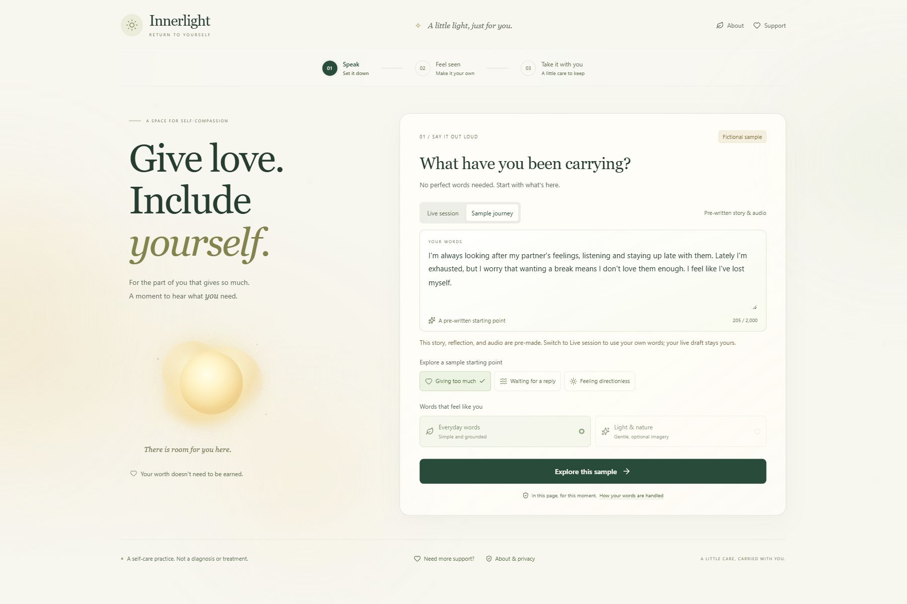
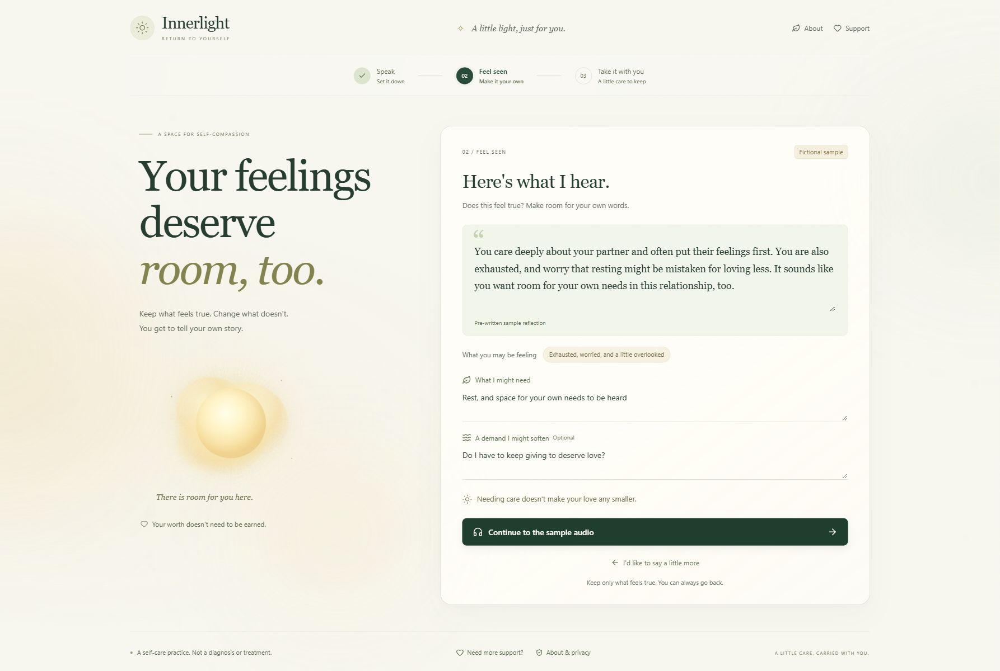
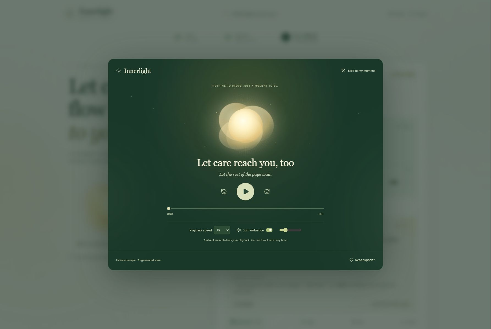
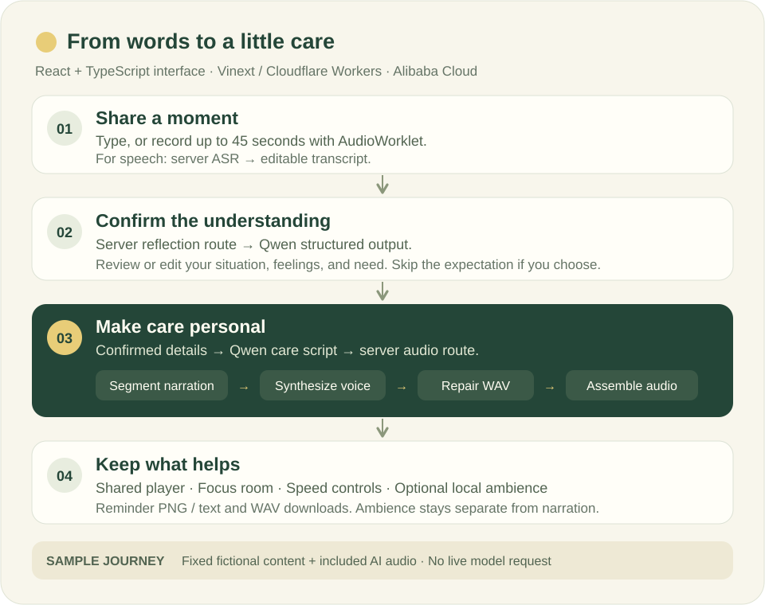

<div align="center">

# Innerlight

### Give love. Include yourself.

A little room for the person who is always making room for others.

**Voice-first self-care · An understanding you can edit · A reflection to carry with you**

[Project homepage](https://yujun-lu.github.io/innerlight/) · [Hosted prototype](https://innerlight-return-to-yourself.niftymint24.chatgpt.site) · [Run locally](#run-locally) · [Architecture](#how-it-works)

<br>



*Speak → Feel seen → Take it with you.*

</div>

## Why Innerlight

> “I care about them. I'm exhausted. Why does taking a break feel selfish?”

People who care deeply for others sometimes lose touch with their own needs. Innerlight offers a quiet place to put a difficult moment into words, correct the system's understanding, and hear a short reflection shaped by what they actually need.

The project grew from an earlier personal meditation-audio experiment. During the hackathon, we built a new interactive application around that idea, adapting its narration and audio-assembly patterns.

## A moment in three steps

| 01 · Speak | 02 · Feel seen | 03 · Take it with you |
| --- | --- | --- |
| Write what's on your mind, or record up to 45 seconds. Choose everyday words or optional light-and-nature imagery. | Review a tentative understanding of your situation, feelings, needs, and a possible harsh expectation. Edit it, or skip the expectation. | Listen to a personalized English reflection. Keep a reminder, an optional small choice, and words you can adapt to express a need or boundary. |

<table>
  <tr>
    <td width="50%"></td>
    <td width="50%"></td>
  </tr>
  <tr>
    <td align="center"><strong>Your understanding takes precedence.</strong><br>Personalization starts with what you confirm.</td>
    <td align="center"><strong>Let the rest of the page wait.</strong><br>A focus room for listening at your own pace.</td>
  </tr>
</table>

All screenshots above use a clearly labeled fictional sample.

## Try it in two minutes

Explore the [project homepage](https://yujun-lu.github.io/innerlight/), open the [hosted prototype](https://innerlight-return-to-yourself.niftymint24.chatgpt.site), or run it locally. The hosted prototype currently requires authorized access.

1. Select **Sample journey**, then **Giving too much**, **Waiting for a reply**, or **Feeling directionless**.
2. Continue through **Feel seen** to the narrated reflection. Enter the focus room, try seeking or a different speed, and optionally enable soft ambience.
3. Save the reminder as a PNG, copy it, or download the text and WAV narration.
4. Switch to **Live session** to use your own words. Confirm or edit the understanding before generating a new script and audio.

| | Sample journey | Live session |
| --- | --- | --- |
| Content | Three prewritten fictional scenarios | Your typed words or transcribed recording |
| Reflection | Fixed sample; fields are read-only | Generated understanding that you can correct |
| Audio | Included, prerecorded AI narration | Newly generated English narration |
| Provider access | No live model request required | Server credentials and provider availability required |
| Honest behavior | Altered sample inputs are rejected | Failures are shown; no silent substitution with a sample |

## Built with care

- **A voice or a keyboard.** AudioWorklet recording with visible input levels, a 45-second limit, editable transcription, and microphone cleanup. Text entry remains available.
- **Control over the reflection.** Confirmed edits guide generation. Browse samples without losing a live draft, revisit a previous result, cancel, or retry.
- **A listening space.** One shared audio player keeps position and speed across the main view and focus room. Play, pause, seek, skip 15 seconds, or add locally synthesized ambience.
- **Something to keep.** Export a reminder PNG, copy or download its text, and download the narration as WAV. Ambience is separate from the downloaded narration.
- **A calm interface.** Warm glass-like surfaces, amber light, forest-green listening, responsive layouts, keyboard focus states, and reduced-motion support.

## How it works



| Layer | Implementation |
| --- | --- |
| Interface | React 19, TypeScript, Tailwind CSS, Lucide icons |
| Application and hosting | Vinext / Vite, Cloudflare Workers, Sites |
| Structured reflection and scripts | Alibaba Cloud Qwen, validated JSON output |
| Speech input | Web Audio API, AudioWorklet, 16 kHz mono PCM, Alibaba Cloud ASR |
| Narration | Segmented speech synthesis, consistent voice direction and seed, WAV repair and assembly |
| Listening and exports | Shared HTML audio element, local ambience, canvas PNG export |

Credentials remain in server configuration. The application has no long-term database for personal disclosures or generated audio.

## Run locally

**Requirements:** Node.js **22.13+** and npm. For live generation, bring your own Alibaba Cloud credentials and access to the configured models.

```sh
git clone https://github.com/Yujun-Lu/innerlight.git
cd innerlight
npm install
```

Copy the environment template:

```powershell
# Windows PowerShell
Copy-Item .env.example .dev.vars
```

```sh
# macOS / Linux
cp .env.example .dev.vars
```

To try only the included samples, the placeholder values can remain. To enable live processing, fill in `.dev.vars` with your own credentials:

| Variable | Purpose |
| --- | --- |
| `DASHSCOPE_API_KEY` | Server credential for reflection, script generation, and transcription |
| `DASHSCOPE_REGION` | `cn-beijing` by default; text and ASR also support `ap-southeast-1` in this implementation |
| `TEXT_MODEL` / `ASR_MODEL` | Model identifiers; defaults are included in `.env.example` |
| `SFM_WORKSPACE_ID` | Workspace for narration; this TTS implementation requires `cn-beijing` |
| `TTS_API_KEY` / `TTS_WORKSPACE_ID` | Optional separate narration credentials |

```sh
npm run dev
```

Visit **http://127.0.0.1:5173**. On Windows, `Start_Demo.cmd` also launches the existing local setup. Microphone capture requires permission and HTTPS or localhost.

Never put credentials in browser code or commit `.dev.vars`. Local secrets are ignored by Git; production secrets are configured separately in Sites.

## Verification

```sh
npm run typecheck
npm test
npm run build
```

The [October 28 release verification](qa/VERIFICATION.md) records **46 passing automated tests**, a successful TypeScript check and production build, real-provider reflection and audio generation, browser playback and downloads, mobile layouts, focus controls, and reminder PNG inspection. The record distinguishes implemented microphone capture from physical-microphone testing, which was not manually exercised in that review.

To regenerate the fictional sample recordings with your own configured provider access:

```sh
node --experimental-strip-types scripts/generate-samples.mjs
```

Sample regeneration and live generation can incur provider charges. Audio generation may take several minutes. Cancelling an application request cannot guarantee that upstream processing or billing has stopped.

## Privacy and scope

Live text, recorded speech, and generated scripts are sent to Alibaba Cloud for the requested processing, subject to the provider's policies. Active results stay in the current page's memory unless you explicitly download them; the application does not write them to a long-term database. This does not make live processing local-only or establish a provider retention guarantee.

Innerlight is an **emotional well-being prototype**. It does not diagnose, provide treatment, or have established clinical effectiveness. Generated reflections can misunderstand a situation. An always-visible support path and bounded routing for explicit immediate-danger statements are implemented, but cannot identify every possible situation. Optional imagery is presented as an invitation, without supernatural or health-outcome claims.

## Project map

```text
app/                 Interface and server API routes
lib/                 Session flow, audio, exports, samples, provider logic
public/              Included fictional sample recordings and worklet
tests/               Backend, session, PCM, and microphone-resource checks
scripts/             Development, builds, provider checks, sample generation
docs/                Project homepage and README screenshots
qa/                  Release verification and visual evidence
```

## Sources and next steps

The next work is consent-based user testing, qualified mental health review, lower generation latency, voice consistency, and real-device microphone testing.

- [Alibaba Cloud audio generation API](https://help.aliyun.com/zh/model-studio/audio-generation-api)
- [Alibaba Cloud Qwen structured output](https://help.aliyun.com/en/model-studio/qwen-structured-output)
- [WHO: Doing What Matters in Times of Stress](https://www.who.int/publications-detail-redirect/9789240003927) — grounding, making room for feelings, kindness, and values-based action. This resource does not establish the effectiveness of Innerlight.

---

<div align="center">

**A little care, carried with you.**

</div>
